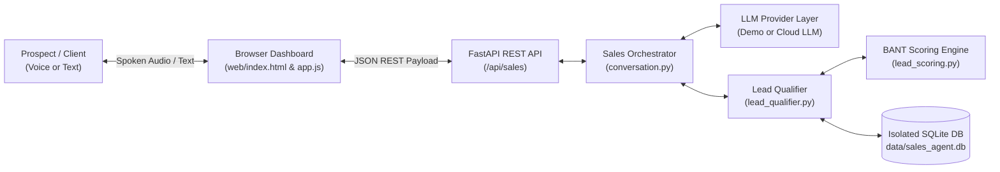

# DRAX AI — Autonomous AI Sales Voice Agent

> An Autonomous Inbound AI Sales Voice Agent and Universal Assistant built on FastAPI, Pydantic, isolated SQLite persistence, explainable BANT lead scoring, and browser-native voice interfaces.

[-00ff88?style=for-the-badge&logo=pytest)](https://github.com/drax102/DRAX-AI)
[](https://python.org)
[](https://fastapi.tiangolo.com)
[](LICENSE)

---

## 🎯 Problem Statement

Modern enterprise sales organizations face severe bottlenecks in their inbound pipeline:
- **Delayed SDR Response Times**: B2B buyers expect instant answers. Leads contacting vendors outside standard operating hours often wait 12–48 hours for qualification, causing significant conversion drop-off.
- **Inconsistent Qualification Standards**: Human sales representatives evaluate Budget, Authority, Need, and Timeline (BANT) subjectively, leading to unvetted leads clogging account executive pipelines.
- **High Operational Costs**: 24/7 global human coverage is cost-prohibitive for growing software and services companies.

## 💡 Solution Overview

The **DRAX Autonomous AI Sales Voice Agent** provides a 24/7 conversational discovery and lead qualification assistant. Operating directly in modern browsers via native Web Speech APIs (voice input & voice output) or keyboard text, it:
1. Conducts natural, multi-turn consultative discovery dialogues.
2. Extracts commercial parameters (name, company, email, phone, role, budget, timeline, authority, and business need) using non-destructive entity merging.
3. Evaluates prospective clients using a deterministic, transparent **0–100 BANT Lead Scoring Rubric** with human-readable reasoning for every awarded point.
4. Stores conversation history and lead records in an **isolated SQLite database** (`data/sales_agent.db`), completely decoupled from the existing Drax assistant records.
5. Runs locally out-of-the-box with a zero-cost deterministic **Demo Engine**, with complete plug-and-play support for any OpenAI-compatible API (OpenAI, Groq, OpenRouter, vLLM).

---

## ✨ Key Features

- 🎙️ **Dual-Modality Voice & Text Interface**: Full hands-free conversation using browser Web Speech API (`SpeechRecognition` for STT with visual pulsing, `SpeechSynthesis` for natural TTS response playback).
- 🧠 **Consultative Sales Orchestrator**: Directs the flow of conversation logically, asking single focused follow-up questions without overwhelming the prospect.
- 📊 **Live Lead Intelligence Panel**: Real-time radial score badge (0–100), 4 animated BANT progress bars (/25 each), and a dynamic customer detail card.
- ⚖️ **Explainable BANT Scoring Engine**:
  - **Budget (0–25)**: Evaluates numeric amounts ($\ge \$10\text{k} \to 25$, $\$2\text{k}\text{--}\$10\text{k} \to 18$, starter $\to 8$, zero budget $\to 0$).
  - **Authority (0–25)**: Sole decision-makers $\to 25$, evaluation committee / co-decision $\to 18$, influencers $\to 10$. Job title alone is never assumed to be decision authority.
  - **Need (0–25)**: High-impact automation/call center pain point $\to 25$, operational/efficiency/security goal $\to 15$, general curiosity $\to 10$, no need $\to 0$.
  - **Timeline (0–25)**: Urgent / $< 1$ month $\to 25$, near-term / 1–3 months / next quarter $\to 18$, medium-term / 3–6 months $\to 10$, indefinite $\to 5$, unmentioned $\to 0$.
- 🛡️ **Enterprise Security & XSS Immunity**: Parameterized SQL queries, sanitized DOM text rendering, 128-bit CSPRNG session IDs (`sales_[0-9a-f]{32}`), and sensitive token redaction in logs.
- 💾 **Strict Storage Isolation**: Dedicated SQLite database (`data/sales_agent.db`) keeping sales records completely separate from the core desktop assistant (`data/drax.db`).
- 🔄 **Pluggable LLM Backend**: Seamlessly toggles between the local deterministic `DemoLLMProvider` and cloud `OpenAICompatibleProvider`.

---

## 🏗️ Architecture Overview



For full architectural diagrams and data flows, see [docs/ARCHITECTURE.md](docs/ARCHITECTURE.md).

---

## 📚 Project Documentation Index

- 🏛️ [System Architecture & Data Flows](docs/ARCHITECTURE.md): Detailed component breakdown, Mermaid sequence diagrams, and database isolation.
- 📋 [One-Page Project Report](docs/PROJECT_REPORT.md): Executive summary prepared for hiring manager review.
- 📈 [Scalability, Security & Cost Roadmap](docs/SCALABILITY.md): 100k-user architectural proposal, security architecture, and mathematical cost model.
- 🎯 [Technical Interview Preparation](docs/INTERVIEW_PREPARATION.md): 14 concise, speakable technical answers to anticipated interview questions.
- 🎬 [Live Demonstration Script](docs/DEMO_GUIDE.md): 3–5 minute step-by-step presentation walkthrough with realistic persona data.

---

## 💻 Technology Stack

- **Backend**: Python 3.10+, FastAPI, Pydantic v2, Uvicorn, SQLite 3, HTTPX.
- **Frontend**: Vanilla JavaScript (ES6+), CSS3 Flexbox/Grid (dark cyan cyberpunk theme), HTML5.
- **Browser Voice APIs**: Web Speech API (`SpeechRecognition` / `webkitSpeechRecognition` & `SpeechSynthesis`).
- **Testing**: Pytest, FastAPI `TestClient`, Unittest mock fixtures.

---

## 📁 Project Directory Structure

```text
drax-ai-v2/
├── backend/
│   ├── sales_agent/               # [NEW] Autonomous AI Sales Voice Agent Module
│   │   ├── __init__.py
│   │   ├── conversation.py        # Dialogue orchestrator & consultative persona
│   │   ├── database.py            # Isolated SQLite persistence (sales_agent.db)
│   │   ├── lead_qualifier.py      # Entity extraction & non-destructive merging
│   │   ├── lead_scoring.py        # Explainable 0-100 BANT rubric & reasoning
│   │   ├── llm_provider.py        # OpenAI-compatible client & Demo fallback
│   │   ├── router.py              # FastAPI APIRouter (/api/sales endpoints)
│   │   └── schemas.py             # Pydantic validation schemas
│   ├── services/
│   │   └── api_service.py         # Main local FastAPI service & static mount
│   └── ...                        # Core Drax assistant modules
├── cloud/
│   └── main.py                    # Cloud production FastAPI entry point
├── data/
│   ├── sales_agent.db             # [ISOLATED] Dedicated Sales Agent database
│   └── drax.db                    # Core Drax assistant database
├── docs/
│   ├── ARCHITECTURE.md            # Detailed component & data flow diagrams
│   ├── PROJECT_REPORT.md          # 1-page executive hiring submission report
│   ├── SCALABILITY.md             # 100k user scalability, security & cost model
│   ├── INTERVIEW_PREPARATION.md   # Speakable Q&A guide for technical evaluations
│   └── DEMO_GUIDE.md              # 3-5 minute live demonstration walkthrough script
├── tests/
│   ├── test_sales_agent.py        # 33 targeted sales agent unit tests
│   ├── test_e2e_verification.py   # Multi-turn customer lifecycle verification test
│   └── ...                        # 103 existing Drax core tests
└── web/
    ├── app.js                     # Web controller, Web Speech STT/TTS, REST client
    ├── index.html                 # Dashboard markup with Sales Voice Agent tab
    └── styles.css                 # Cybernetic responsive styles & BANT meters
```

---

## 🚀 Installation & Setup

### 1. Prerequisites
- Python 3.10 or higher
- Google Chrome, Microsoft Edge, or Safari (for Web Speech voice recognition)

### 2. Environment Setup
```bash
# Clone the repository
git clone https://github.com/drax102/DRAX-AI.git
cd DRAX-AI

# Activate existing virtual environment (or create a new one)
.\venv\Scripts\activate   # Windows
# source venv/bin/activate # Linux/macOS

# Install dependencies if starting fresh
pip install -r requirements.txt
```

### 3. Environment Configuration (`.env`)
Create or edit `.env` in the root directory:

```ini
# --- Autonomous Sales Voice Agent Configuration ---
# Leave blank to use the built-in deterministic Demo Engine (Zero Cost, No API keys required)
SALES_LLM_API_KEY=
SALES_LLM_BASE_URL=https://api.openai.com/v1
SALES_LLM_MODEL=gpt-4o-mini
SALES_LLM_TIMEOUT_SECONDS=15.0

# --- General System Settings ---
DRAX_ENV=development
```

> [!TIP]
> If `SALES_LLM_API_KEY` is not provided, the system automatically runs in **Demo Mode** (`demo-sales-engine`). It requires no internet access or API credits and generates realistic consultative responses for evaluation.

---

## ⚡ Application Startup

Run the verified startup command in your terminal:

```bash
.\venv\Scripts\python -m uvicorn backend.services.api_service:api_app --host 127.0.0.1 --port 8765
```

Open your browser to:
**`http://localhost:8765`**

Click the **"Sales Voice Agent"** button in the sidebar to open the live sales qualification terminal.

---

## 📡 REST API Reference

All sales endpoints are prefixed under `/api/sales`:

| Method | Endpoint | Description | Status Codes |
| :--- | :--- | :--- | :---: |
| `POST` | `/api/sales/sessions` | Initialize a new sales session with 128-bit CSPRNG token | `201 Created` |
| `POST` | `/api/sales/sessions/{session_id}/messages` | Send customer voice transcript/text & get AI response with live score | `200 OK`, `400`, `404`, `502`, `504` |
| `GET` | `/api/sales/sessions/{session_id}/history` | Retrieve chronological dialogue turns for the session | `200 OK`, `404` |
| `GET` | `/api/sales/sessions/{session_id}/lead` | Retrieve live BANT qualification scores, breakdown, and lead details | `200 OK`, `404` |

---

## 🧪 Testing Instructions

Run the complete test suite (137 tests):

```bash
# Run all project tests (Core Drax + Sales Agent + E2E Lifecycle)
.\venv\Scripts\pytest tests/ -v

# Run only the Sales Voice Agent test suites
.\venv\Scripts\pytest tests/test_sales_agent.py tests/test_e2e_verification.py -v
```

**Verification Results**:
- `tests/test_sales_agent.py`: 33 passed
- `tests/test_e2e_verification.py`: 1 passed (complete customer journey)
- Full Project Suite: **137 passed in ~60 seconds (100% pass rate, 0 regressions)**

---

## 📸 Interface Screenshots

| Sales Voice Agent Split Interface | Live BANT Lead Intelligence Panel |
| :---: | :---: |
| `[Screenshot Placeholder: web/screenshots/sales_terminal.png]` *(Dialogue terminal with user voice input & AI consultative response)* | `[Screenshot Placeholder: web/screenshots/lead_intelligence.png]` *(Radial score badge, 4 BANT progress bars & customer details)* |

---

## ⚠️ Known Limitations & Evaluation Disclosures

1. **Active LLM Engine**: The current active provider is `DemoLLMProvider` (`demo-sales-engine`). While the `OpenAICompatibleProvider` is implemented and unit-tested via mock fixtures, live external LLM API connectivity has NOT been validated against external paid endpoints in this environment.
2. **Physical Voice Hardware**: Software-level Web Speech API integration is implemented and tested in code; live acoustic verification with physical microphones and speakers across diverse hardware setups remains marked as pending manual user evaluation.
3. **Storage Concurrency**: Current MVP uses SQLite with thread locking (`data/sales_agent.db`). For concurrent enterprise scale, migrate to managed PostgreSQL as detailed in the scalability proposal.
4. **Scalability Disclosure**: The 100,000-user architecture in [docs/SCALABILITY.md](docs/SCALABILITY.md) is an architectural and systems design proposal, not an empirical load-tested result.
5. **Browser Speech Costs**: While browser-native Web Speech incurs no direct backend API billing, proprietary browser engines (such as Chrome) process speech through vendor services subject to quota and policy variations, and browsers like Firefox lack native support.
6. **Session Authentication**: Current MVP utilizes 128-bit CSPRNG session IDs (`sales_[0-9a-f]{32}`). Production multi-tenant deployments should pair session IDs with signed JWT bearer tokens and RBAC.

---

## 🔮 Future Improvements

- [ ] **Streaming Speech (SSE)**: Stream token generation and audio chunks for $< 250\text{ms}$ time-to-first-voice response.
- [ ] **CRM Integrations**: Direct webhook dispatches to Salesforce, HubSpot, and Marketo when lead status reaches `QUALIFIED`.
- [ ] **Calendar Integration**: Direct booking integration (Calendly / Cal.com API) within the voice dialogue when high buying intent is detected.
- [ ] **PostgreSQL Migration**: Production relational schema with connection pooling for 100k user horizontal scale.
