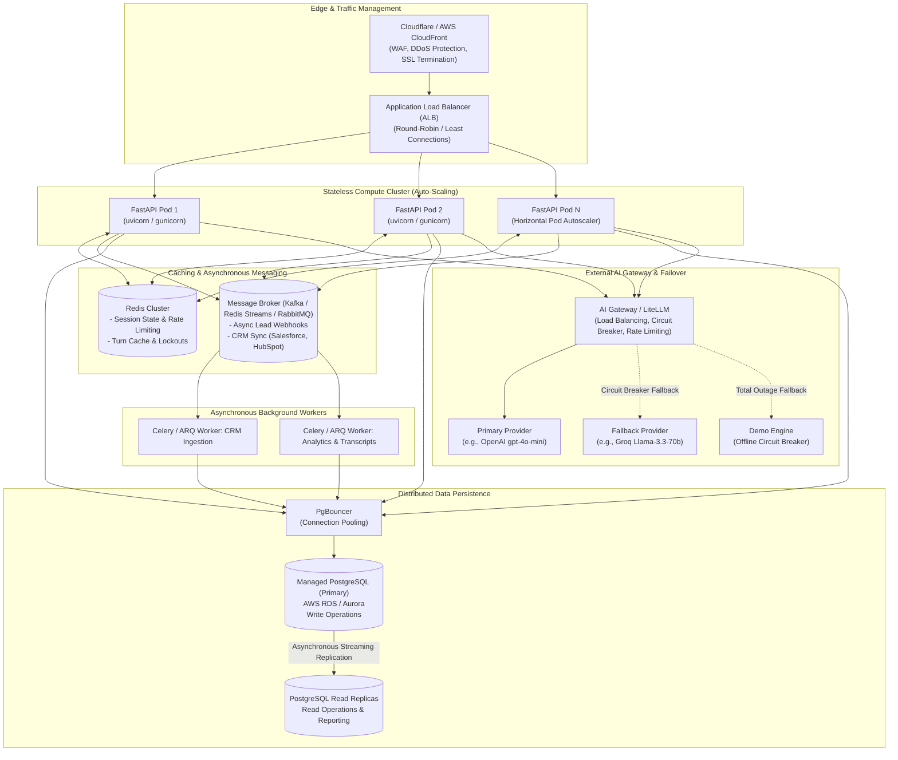

# Scalability, Security, Deployment & Cost Analysis

This document outlines the architectural roadmap for scaling the **Autonomous AI Sales Voice Agent** from its current functional MVP to a production-grade enterprise deployment capable of serving **100,000 active users**.

---

## 1. High-Concurrency Production Architecture (Target: 100,000 Users)

> [!IMPORTANT]
> **Architectural Proposal Notice**: The 100,000-user scalability design described in this document represents a **conceptual and architectural proposal** for enterprise cloud migration. The current working MVP operates on a single local FastAPI instance with an isolated SQLite database (`data/sales_agent.db`) and has not been subjected to empirical 100,000-user load testing.

The current MVP uses a local SQLite database (`data/sales_agent.db`) and a single-process FastAPI server. While ideal for local development, deterministic evaluation, and technical hiring demos, a production system handling 100,000 concurrent prospects requires a distributed, stateless architecture.

---

## 2. Technical Scaling Roadmap

### A. Transition from SQLite to Managed PostgreSQL
- **MVP State**: Single SQLite database with Python thread locking (`PRAGMA journal_mode=WAL`). SQLite allows only a single writer at any given moment.
- **Production Target**: Managed PostgreSQL (e.g., AWS Aurora PostgreSQL or Supabase) with:
  - Connection pooling via **PgBouncer** to handle 10,000+ simultaneous connections without exhausting database socket limits.
  - Read-write splitting: mutations write to the primary; live dashboard queries read from read replicas.
  - Partitioning of `sales_conversation_turns` by `created_at` (monthly or quarterly partitions) to maintain query performance as millions of turns accumulate.

### B. Caching & Session Management via Redis
- **MVP State**: Session state maintained in client `sessionStorage` and fetched from disk on each message turn.
- **Production Target**: Multi-node Redis cluster:
  - **Session Cache**: Cache recent dialogue turns in Redis with a 2-hour TTL. Avoids disk roundtrips during active conversations.
  - **Rate Limiting**: Sliding-window Token Bucket rate limiting in Redis (e.g., max 30 messages/minute per IP or session) to prevent API exhaustion.

### C. Asynchronous Background Task Processing
- **MVP State**: Entity extraction, BANT scoring, and dialogue orchestration happen synchronously within the request lifecycle.
- **Production Target**: Asynchronous task queues using **Celery** or **ARQ**:
  - The API synchronously generates the LLM response and updates the BANT score for zero-latency client feedback.
  - CRM synchronization (pushing qualified leads to Salesforce, HubSpot, or Marketo), heavy transcript NLP, and audio archival are dispatched to background workers.

### D. LLM Concurrency, Streaming & Gateway Failover
- **Streaming Responses**: Transition from block JSON to Server-Sent Events (SSE) or WebSockets. Prospects hear speech within 250ms of generation rather than waiting for the entire text completion.
- **AI Gateway with Circuit Breakers**: Use an AI proxy (e.g., LiteLLM Proxy or Portkey) with automatic fallbacks:
  - Primary: Fast cloud completions (e.g., `gpt-4o-mini`).
  - Secondary fallback: High-throughput open models (e.g., Groq `llama-3.3-70b-versatile`).
  - Tertiary fallback: Deterministic offline demo engine to maintain basic service availability during global AI provider outages.

---

## 3. Security & Compliance Architecture

| Security Domain | Implemented in Current MVP | Proposed Production Enhancement |
| :--- | :--- | :--- |
| **Credential Management** | `SALES_LLM_API_KEY` read from environment; masked in logs via regex. | AWS Secrets Manager / HashiCorp Vault with dynamic rotation. Zero secrets in source or environment files. |
| **Transport Security** | Localhost execution / standard HTTP. | Strict TLS 1.3 encryption across all edge and internal endpoints; HSTS header enforcement. |
| **Session Protection** | 128-bit CSPRNG tokens (`sales_[0-9a-f]{32}`). | Ephemeral JWT Bearer tokens with cryptographic signatures (Ed25519) and short TTLs (15 min). |
| **SQL Injection** | Parameterized SQL queries via SQLite DB API (`?` placeholders). | Parameterized SQLAlchemy ORM / asyncpg queries with static analysis security audits (Bandit). |
| **XSS Immunity** | Sanitized DOM rendering (`textContent` rather than `innerHTML`). | Content Security Policy (CSP) headers restricting script execution to approved hashes. |
| **Data Privacy & PII** | In-memory regex parsing. | Automated PII masking (scrubbing credit cards, SSNs, personal phone numbers) before long-term storage; GDPR-compliant data deletion endpoints. |

---

## 4. Proposed Cloud Deployment Blueprint

*(Note: The deployment architecture below represents the proposed production design. The current MVP runs locally via Uvicorn).*

- **Containerization**: Multi-stage Docker container based on `python:3.11-slim` running non-root.
- **Orchestration**: AWS Elastic Container Service (ECS) with Fargate (serverless containers) or Kubernetes (EKS).
- **Auto-Scaling Policy**: Horizontal Pod Autoscaler (HPA) configured to scale out compute pods when average CPU exceeds 65% or active request queues exceed 50.
- **Static Frontend**: Static assets hosted on Amazon S3 and distributed globally through AWS CloudFront CDN.

---

## 5. Operational Cost Model

Production operating costs depend on user traffic volume, conversation duration, and provider selection. Rather than inventing arbitrary monthly dollar amounts, the model below defines the exact cost calculation formula.

### A. Cost Calculation Formula

$$\text{Total Monthly Cost} = C_{\text{Compute}} + C_{\text{DB}} + C_{\text{Cache}} + C_{\text{LLM}} + C_{\text{Audio}} + C_{\text{Network}}$$

Where:
- $C_{\text{Compute}}$: Container instances (e.g., AWS Fargate: $\text{vCPU count} \times \text{hours} \times \text{vCPU rate} + \text{RAM GB} \times \text{hours} \times \text{RAM rate}$).
- $C_{\text{DB}}$: Managed PostgreSQL instance + storage volume + backup snapshot storage.
- $C_{\text{Cache}}$: Managed Redis cluster instance (e.g., AWS ElastiCache).
- $C_{\text{LLM}}$: Inbound and outbound token consumption:
  $$C_{\text{LLM}} = (\text{Total Conversations} \times \text{Avg Turns} \times \text{Tokens per Turn}) \times \frac{\text{Price per Million Tokens}}{1,000,000}$$
- $C_{\text{Audio}}$: Speech synthesis and recognition:
  - **Browser-Native Web Speech API (Current MVP)**: Incurs no direct per-request backend API billing in supported browsers. However, zero cost cannot be universally guaranteed across all enterprise environments: proprietary browser engines (such as Chrome) process speech through vendor services subject to quota, connectivity, or policy variations, and browsers like Firefox lack native support.
  - **Dedicated Cloud Voice Engines (Production Option)**: Standard enterprise deployments typically integrate dedicated STT/TTS (e.g., Deepgram, OpenAI Whisper, ElevenLabs) for guaranteed cross-browser fidelity: $\text{Audio Minutes} \times \text{Per-Minute Rate}$.
- $C_{\text{Network}}$: Data transfer egress from cloud CDN to client browsers.

### B. Free/Demo vs. Production Tier Comparison

| Component | Current MVP (Offline Demo Mode) | Production Scale Proposal (100,000 Users) |
| :--- | :--- | :--- |
| **LLM Inference** | **\$0.00** (Local deterministic `DemoLLMProvider` active) | Variable based on vendor token pricing (e.g., \$0.15/M input tokens for GPT-4o-mini via `OpenAICompatibleProvider`) |
| **Speech Processing** | **\$0.00 direct backend billing** (Browser-native Web Speech API; physical mic verification pending) | \$0.00 if client Web Speech is retained; or \$0.004–\$0.015/min if dedicated cloud speech engines are adopted |
| **Database** | **\$0.00** (Local isolated SQLite file `data/sales_agent.db`) | \$100 – \$400/month for multi-AZ managed PostgreSQL cluster with PgBouncer pooling |
| **Compute Hosting** | **\$0.00** (Local developer machine on `localhost:8765`) | Auto-scaling container cluster based on compute vCPU/RAM hours |
